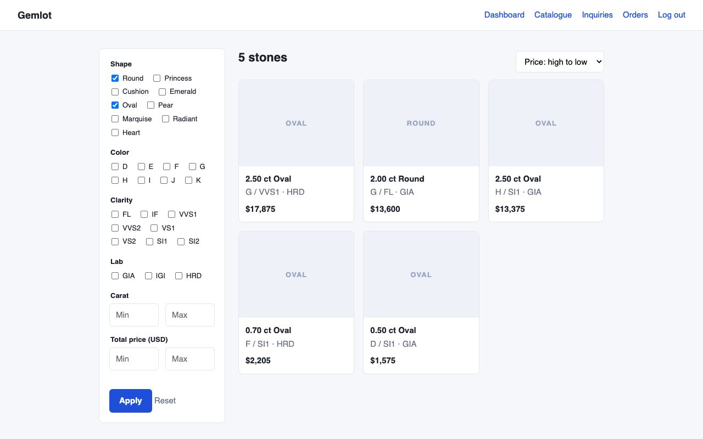
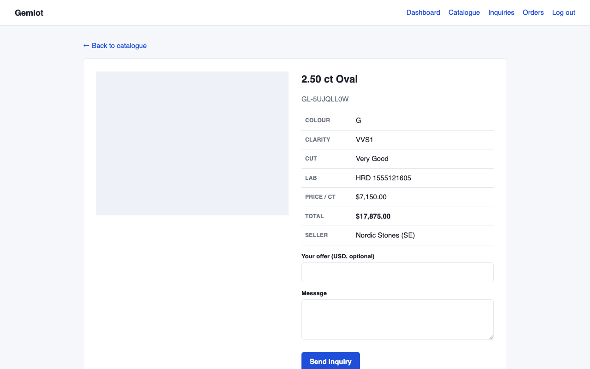
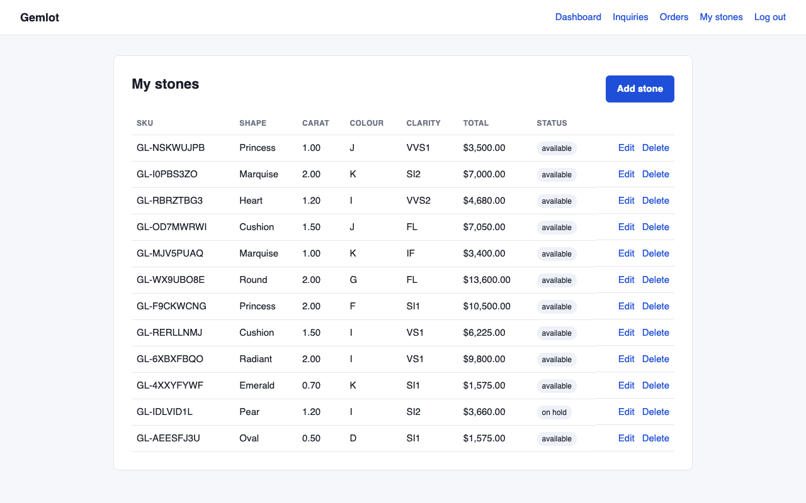
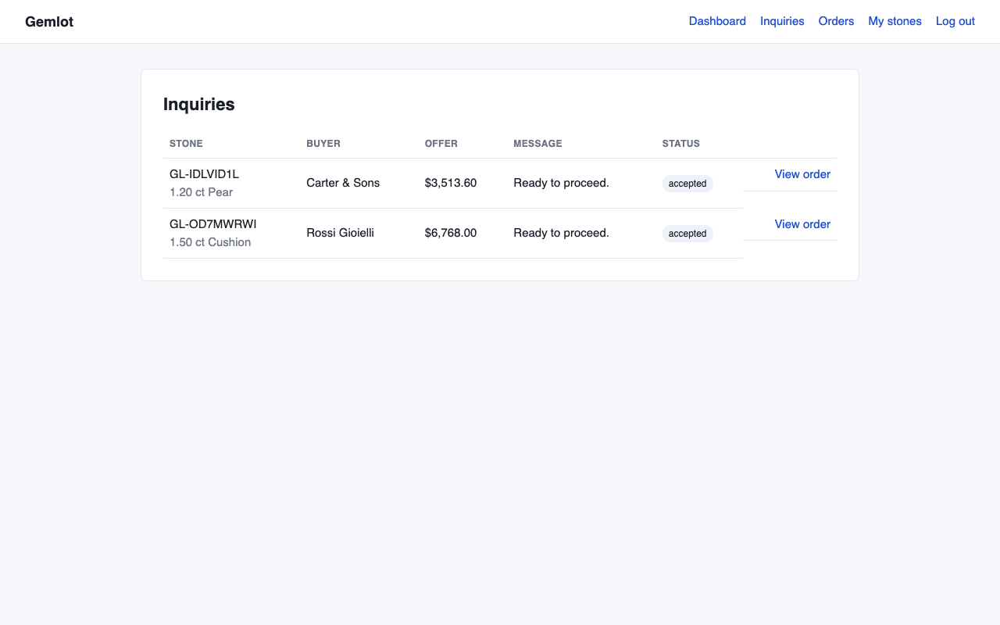

# Gemlot

A small B2B marketplace where sellers list wholesale gemstones and trade buyers browse, make offers and place orders. It is a portfolio project built with Laravel 12 and MySQL, covering the parts of trading platforms I have worked on before: role-based access, search and filtering, an approval flow for sellers, an order lifecycle, and a REST API for a mobile app.

It is a demo and is not connected to any real business or client.



## What it does

- **Three roles.** Buyers, sellers and admins, each with their own pages and permissions.
- **Seller approval.** New sellers can register straight away but cannot list anything until an admin approves them.
- **Stone listings.** Sellers manage their own stock, with photo upload and a price per carat. The total price is stored so it can be filtered and sorted in SQL.
- **Catalogue.** Buyers filter by shape, colour, clarity, lab, carat range and total price, and sort by price, carat or newest. Only available stones from approved sellers show up.
- **Inquiries and offers.** A buyer can ask about a stone and optionally name a price.
- **Orders.** When a seller accepts an inquiry the stone is put on hold and an order is created. The order then moves through confirmed, shipped and completed, or can be cancelled.
- **REST API.** Token login (Sanctum), the same catalogue filters, inquiries and orders, so a mobile app can do everything a buyer or seller can do on the website.

| Stone page | Seller stock | Seller inquiries |
|---|---|---|
|  |  |  |

## Order lifecycle

```
            confirm (seller)     ship (seller)     complete (buyer)
 pending ───────────────▶ confirmed ─────────▶ shipped ──────────────▶ completed
    │                        │
    └──── cancel (buyer or seller) ────┘
                 │
                 ▼
             cancelled   (the stone goes back on sale)
```

The rules live in one place, `Order::ACTIONS`: which statuses each step can start from, where it ends up, and who may trigger it. The policy, the views and the API all read from it, so they cannot drift apart.

Accepting an inquiry runs in a transaction with row locks on the stone and the inquiry. That stops two accepts from both winning the same stone. Accepting also declines any other open inquiries on that stone.

## Getting started

You need PHP 8.2+, Composer and Docker (for MySQL).

```bash
git clone git@github.com:AJayBhimani74/gemlot.git
cd gemlot

composer install
cp .env.example .env
php artisan key:generate

docker compose up -d          # MySQL 8.4 on port 3307
php artisan migrate --seed    # tables and an admin user
php artisan db:seed --class=DemoSeeder   # optional sample data
php artisan storage:link

php artisan serve
```

Then open http://localhost:8000.

### Demo accounts

All demo accounts use the password `password`.

| Role | Email |
|---|---|
| Admin | admin@gemlot.test |
| Seller (approved) | anil@mehtagems.test |
| Seller (waiting for approval) | wei@pearlriver.test |
| Buyer | maria@rossijoyas.test |

## API

Base path `/api/v1`. All responses are JSON, including errors.

```bash
# log in and get a token
curl -X POST http://localhost:8000/api/v1/auth/login \
  -H 'Content-Type: application/json' \
  -d '{"email":"maria@rossijoyas.test","password":"password","device_name":"my-phone"}'

# browse round stones, cheapest first
curl 'http://localhost:8000/api/v1/stones?shape[]=Round&sort=price_asc' \
  -H 'Authorization: Bearer <token>'
```

| Method | Path | Who | Purpose |
|---|---|---|---|
| POST | `/auth/login` | anyone | Exchange credentials for a token (rate limited) |
| POST | `/auth/logout` | any | Revoke the current token |
| GET | `/me` | any | Current user |
| GET | `/stones` | buyer, admin | Catalogue with filters, sorting and pagination |
| GET | `/stones/{id}` | buyer, admin | Stone detail |
| POST | `/stones/{id}/inquiries` | buyer | Send an inquiry or offer |
| GET | `/inquiries` | buyer, seller | Your inquiries (sent or received) |
| POST | `/inquiries/{id}/withdraw` | buyer | Withdraw an open inquiry |
| POST | `/inquiries/{id}/accept` | seller | Accept and create an order |
| POST | `/inquiries/{id}/decline` | seller | Decline |
| GET | `/orders`, `/orders/{id}` | buyer, seller, admin | Your orders |
| POST | `/orders/{id}/{action}` | buyer, seller | `confirm`, `ship`, `complete` or `cancel` |

Each order in a response includes `available_actions`, the steps the current user can take right now, so a client can show only the buttons that make sense.

Catalogue filters: `shape[]`, `color[]`, `clarity[]`, `lab[]`, `carat_min`, `carat_max`, `price_min`, `price_max`, plus `sort` (`newest`, `price_asc`, `price_desc`, `carat_asc`, `carat_desc`) and `per_page` (max 50).

## Tests

```bash
php artisan test
vendor/bin/pint --test    # code style
```

The suite has around 70 tests. They run on in-memory SQLite, so they never touch the development database. They cover registration and login, seller permissions, the approval gate, every catalogue filter, the full order lifecycle including a table of who may do what at each status, and the API. GitHub Actions runs the style check and the tests on PHP 8.2 and 8.3 for every push.

## Project layout

```
app/
  Http/Controllers/          web controllers (Auth, Seller, Admin) and Api/V1
  Http/Middleware/           role and approval checks
  Http/Resources/            API response shapes
  Models/                    Stone, Inquiry, Order, User, with query scopes
  Policies/                  who may act on which stone, inquiry or order
  Services/OrderService.php  accepting inquiries and moving orders along
database/                    migrations, factories, seeders
tests/                      Feature (web and Api) and Unit
```

## Decisions worth mentioning

- **Business rules are not in controllers.** Both the website and the API call `OrderService`, so there is one implementation of what accepting or shipping means.
- **Shared query scopes.** `catalogue()`, `filter()`, `sortBy()` and `visibleTo()` are used by both the web and API controllers.
- **Policies over inline checks.** Ownership and state rules (a seller can only edit their own stones, a sold stone cannot be deleted) are in policy classes and covered by tests.
- **Soft deletes on stones.** Past orders and inquiries still point at a stone that has been removed.
- **Whitelisted inputs.** Filter and sort values are checked against known lists, and unknown values are ignored.

## Possible next steps

Email notifications for new inquiries and order changes, an audit trail of status changes, image resizing, and per-seller sales reports.
